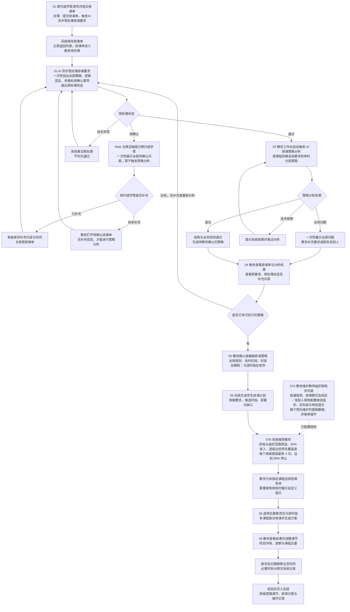

# 智能排课V3.0：AI算法排课

本图描述目标业务流程。顾问或学管提交排课单后，立即触发 AI 异步预处理排课要求；无需等待分析完成，排课单即进入教务待处理。预处理状态为“通过”时，教务工作台自动触发策略分析；状态为“待确认”时，先补充信息并重新预处理，通过后再分析策略。当前静态原型中的 AI 结果与课节均为演示数据。

## 关键业务口径

- 提交排课单时触发 AI 异步预处理，顾问或学管无需等待结果。预处理返回“通过”或“待确认”；技术异常由系统单独重试，不视为通过。
- “通过”时教务工作台自动触发 AI 排课策略分析。“待确认”时提示顾问或学管补充，暂不触发策略分析；如果顾问未补充，教务打开排课单后须补充信息。两种补充都重新预处理，通过后再触发策略分析。排课单仍可流转和查看。
- AI 预处理和策略分析都应一次性列出已识别的全部业务问题，避免逐项往返沟通。技术故障单独提示。
- 顾问补充以独立字段留存，展示补充时间与内容。若策略已生成，教务可选择重新生成或继续当前策略；下次重新生成时自动带入补充内容。
- 教师组织架构优先级属于预先维护的基础数据。系统推荐时读取已配置规则和当前学生排课计划，再依次完成选师、联合排课及正式课节；课节写入时才换算到北京时区。
- 确认排课策略时，教务可在每门课程的 AI 分析文字下指定授课老师；未指定的课程再进入教师推荐和选择。已指定老师不参加推荐排序，但仍校验真实日程与硬约束。
